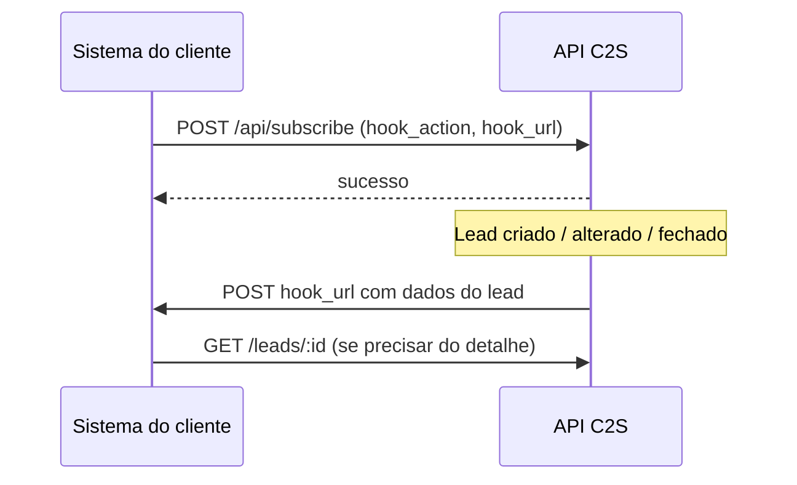

# API C2S — Tutorial passo a passo por endpoint

27/09/2026 · Lucas Cardoso

## Como usar este guia

Este guia ensina o time de Suporte a testar cada endpoint da API C2S no Postman, do token até o webhook, para resolver casos de API sem escalar. Cada endpoint segue o mesmo roteiro: **para que serve → como montar no Postman → corpo de exemplo → o que esperar na resposta → erros típicos**.

- **Fonte:** referência oficial em [docs-api-leads.c2sapp.com](https://docs-api-leads.c2sapp.com/).
- **Regra de ouro:** teste sempre com o token de uma conta de teste ou com autorização do cliente. Endpoints de escrita (POST, PUT, PATCH) alteram dados reais.

## Preparação: token e Postman

Toda chamada vai para `https://api.contact2sale.com/integration` com o token no header `Authorization: Bearer <token>`. A API também aceita o header alternativo `Authentication: <token>`, sem a palavra Bearer. Sem token válido, a API devolve **403** com `{"error":"access_denied"}`.

### Passo 1 — Gerar o token (conta Master)

1. Entre no C2S pelo computador e clique em **Integrações** no menu lateral.
2. Expanda **Informações de integração por e-mail e API**.
3. Clique em **Gerar Token**, dê um nome (ex.: `Postman Suporte`) e confirme.
4. Copie o token na hora: ele aparece **uma única vez**.

Só usuário **Master** gera token. O token dá acesso total à API da empresa: com o token de um cliente, prefira chamadas de leitura (GET).

### Passo 2 — Criar o Environment no Postman

1. Postman → **Environments** → **+** → nome `C2S`.
2. Crie as variáveis abaixo e salve.
3. Selecione o environment `C2S` no canto superior direito.

| Variável | Valor inicial | Uso |
| --- | --- | --- |
| `base_url` | `https://api.contact2sale.com/integration` | Início de toda URL |
| `token` | o token gerado (tipo *secret*) | Autenticação |

### Passo 3 — Criar a Collection com autenticação herdada

1. **New → Collection** → nome `API C2S`.
2. Aba **Authorization** da collection → Type **Bearer Token** → Token `{{token}}`.
3. Em cada request, deixe Authorization como **Inherit auth from parent**.
4. Para POST/PUT/PATCH: aba **Body** → **raw** → **JSON** (o Postman adiciona `Content-Type: application/json`).

### Passo 4 — Primeiro teste: `GET /me` (Informações da Empresa)

1. Nova request: **GET** `{{base_url}}/me` → **Send**.
2. Resposta 200 esperada:

```json
{
  "company_name": "Empresa Exemplo",
  "company_id": "a1b2c3d4e5f6a7b8c9d0e1f2a3b4c5d6",
  "sub_companies": [
    { "company_id": "a1b2c3d4e5f6a7b8c9d0e1f2a3b4c5d6", "company_name": "Empresa Exemplo" }
  ]
}
```

Se veio o nome da empresa certa, o token funciona e pertence a ela. Este é o **primeiro teste em todo caso de API**: confirma token e empresa em 10 segundos.

**Sobre IDs:** os IDs da API são criptografados (texto de 32 caracteres, ex.: `a1b2c3d4...`), não o número que aparece na tela. Pegue-os sempre de uma resposta da API (`/me`, `/sellers`, `/leads`, `/tags`). Exceção: filas de distribuição usam ID numérico.

## Leads

Os 13 endpoints de lead cobrem o ciclo completo: criar, consultar, atualizar, transferir, etiquetar, conversar, agendar, mudar status e fechar negócio. Todos usam `{{base_url}}` e a autenticação herdada da collection.

| # | Método | Caminho | Para que serve |
| --- | --- | --- | --- |
| L1 | POST | `/leads` | Criar Lead |
| L2 | GET | `/leads` | Listar Leads |
| L3 | GET | `/leads/:id` | Buscar Lead por ID |
| L4 | PUT | `/leads/:id` | Atualizar Lead |
| L5 | PATCH | `/leads/:id/forward` | Encaminhar Lead |
| L6 | GET | `/leads/:id/tags` | Listar Tags do Lead |
| L7 | POST | `/leads/:id/create_tag` | Adicionar Tag ao Lead |
| L8 | POST | `/leads/:id/remove_tag` | Remover Tag do Lead |
| L9 | POST | `/leads/:id/mark_as_interacted` | Marcar Lead como Lido |
| L10 | POST | `/leads/:id/create_message` | Criar Mensagem no Lead |
| L11 | POST | `/leads/:id/create_activity` | Criar Atividade no Lead |
| L12 | POST | `/leads/:id/update_status` | Atualizar Status do Lead |
| L13 | POST | `/leads/:id/done_deal` | Fechar Negócio do Lead |

### L1 — Criar Lead (`POST /leads`)

É o endpoint mais usado: portais, sites e automações do cliente entram por aqui.

1. **POST** `{{base_url}}/leads` → Body **raw / JSON**.
2. Cole o corpo abaixo. Atenção ao envelope `data → type → attributes`: só este endpoint usa esse formato.
3. **Send** e confira `success: true` e o `lead_id`.

```json
{
  "data": {
    "type": "lead",
    "attributes": {
      "name": "Pedro Silva",
      "email": "pedro@exemplo.com",
      "phone": "+55 11 99999-9999",
      "description": "Apartamento 2 quartos",
      "prop_ref": "AP12345",
      "price": "R$ 250.000,00",
      "city": "Campinas",
      "neighbourhood": "Botafogo",
      "channel_id": 1,
      "body": "Olá, tenho interesse no imóvel.",
      "source": "portal_zap"
    }
  }
}
```

Resposta esperada (resumo):

```json
{
  "success": true,
  "lead_id": "a1b2c3d4e5f6a7b8c9d0e1f2a3b4c5d6",
  "received_by": { "id": "...", "name": "Maria Vendedora", "email": "maria@exemplo.com" },
  "company": "Empresa Exemplo",
  "info": { "name": "Pedro Silva", "phone": "5511999999999", "channel_id": 1 }
}
```

`received_by` mostra **qual vendedor recebeu** o lead: é a resposta para “para quem foi o lead?”.

Campos que mais geram dúvida:

| Campo | Regra |
| --- | --- |
| `phone` ou `email` | **Um dos dois é obrigatório**; sem eles a API devolve 423 |
| `name` | Opcional; se vazio vira “Não identificado” |
| `prop_ref` | Código do imóvel; necessário para imobiliárias vincularem o anúncio |
| `brand`, `model`, `version`, `year`, `km`, `license_plate` | Dados do veículo (revendas) |
| `description` | Máx. 250 caracteres |
| `body` | Primeira mensagem do cliente; máx. 15.000 caracteres, aceita HTML |
| `channel_id` / `channel_abbrev` | Canal de origem (1 = Internet; abreviaturas como `internet`, `whatsapp`, `telefone`, `showroom`) |
| `source` | Origem do lead, ex.: `portal_zap` |
| `external_id` | ID do lead no sistema do cliente, para rastrear duplicidade |
| `custom_created_at` | Data de criação retroativa (ISO 8601) |
| `tags` / `tag_name` | Tags já na criação |
| `observation` | Nota interna, não é mensagem do cliente |

`channel_id` vai de 1 a 5 (1 = Internet, padrão; 2 = Showroom). Exemplos de `type_negotiation` na doc: `Comprar`, `Alugar`, `Lançamento`.

### L2 — Listar Leads (`GET /leads`)

1. **GET** `{{base_url}}/leads`.
2. Na aba **Params**, adicione só os filtros que precisa.
3. **Send**; o total está em `meta.total` (máx. 50 por página; calcule as páginas com `meta.total ÷ perpage`).

| Parâmetro | Exemplo | Uso |
| --- | --- | --- |
| `phone` | `11999999999` | Achar lead pelo telefone do cliente (com ou sem 55; não acha por parte do número) |
| `email` | `pedro@exemplo.com` | Achar lead pelo e-mail |
| `created_gte` / `created_lt` | `2026-09-01T03:00:00Z` | Leads criados em um período (**só UTC com Z**) |
| `updated_gte` / `updated_lt` | ISO 8601 | Leads alterados em um período |
| `status` | `novo` | Filtrar por status: `novo`, `em_negociacao`, `convertido`, `negocio_fechado`, `arquivado`, `resgatado`, `pendente`, `recusado`, `finalizado` |
| `tags` | `quente,retorno` | Tags separadas por vírgula |
| `sort` | `-created_at` | Ordenação (`-` = mais recente primeiro) |
| `page` / `perpage` | `1` / `50` | Paginação; máximo 50 por página |
| `from_hierarchy_company` | `true` | Não use: dá 403 quando a página inclui um lead criado pela API |

Exemplo pronto: `{{base_url}}/leads?phone=11999999999&sort=-created_at&perpage=10`

Uso no suporte: “o lead do portal chegou?” → filtre por telefone ou e-mail e pelo dia do envio.

### L3 — Buscar Lead por ID (`GET /leads/:id`)

1. **GET** `{{base_url}}/leads/<lead_id>` → **Send**.
2. A resposta traz o lead completo: cliente, vendedor, mensagens, atividades agendadas e tags.

Não use `?from_hierarchy_company=true` aqui: em leads criados pela API devolve 401 com erro interno.

### L4 — Atualizar Lead (`PUT /leads/:id`)

1. **PUT** `{{base_url}}/leads/<lead_id>` → Body raw / JSON.
2. Envie só o que muda, dentro de `lead` (sem o envelope `data`):

```json
{
  "lead": {
    "channel_id": 1,
    "customer": { "name": "Nome Atualizado", "email": "novo@exemplo.com" },
    "product": { "brand": "Toyota", "model": "Corolla" }
  }
}
```

### L5 — Encaminhar Lead (`PATCH /leads/:id/forward`)

1. Rode `GET /sellers` e copie os IDs do vendedor atual e do novo.
2. **PATCH** `{{base_url}}/leads/<lead_id>/forward`:

```json
{
  "seller_from_id": "<id do vendedor atual>",
  "seller_to_id": "<id do novo vendedor>"
}
```

3. Confira o novo `seller_id` na resposta.

### L6, L7, L8 — Listar Tags do Lead, Adicionar Tag ao Lead e Remover Tag do Lead

1. Descubra o `tag_id` com `GET /tags` (ver seção Tags).
2. Ver tags: **GET** `{{base_url}}/leads/<lead_id>/tags`.
3. Adicionar: **POST** `{{base_url}}/leads/<lead_id>/create_tag` com `{ "tag_id": "<tag_id>" }`.
4. Remover: **POST** `{{base_url}}/leads/<lead_id>/remove_tag` com `{ "tag_id": "<tag_id>" }` ou uma lista `{ "tag_id": ["id1", "id2"] }`.

### L9 — Marcar Lead como Lido (`POST /leads/:id/mark_as_interacted`)

**POST** `{{base_url}}/leads/<lead_id>/mark_as_interacted`, sem body. A resposta traz `read_at` preenchido. Usado quando o atendimento acontece fora do C2S (ex.: um chatbot) e o lead não deve ficar como “não lido”.

### L10 — Criar Mensagem no Lead (`POST /leads/:id/create_message`)

Usado por chatbots e integrações de WhatsApp para gravar a conversa no histórico do lead.

```json
{
  "body": "Texto da mensagem",
  "from": "bot",
  "origin": "whatsapp",
  "message_type": "text",
  "sender_name": "Assistente Virtual",
  "created_at": "2026-09-23T10:00:00-03:00"
}
```

Opcionais: `url`, `external_id`, `parent_message_id`, `tags`.

### L11 — Criar Atividade no Lead (`POST /leads/:id/create_activity`)

```json
{
  "date": "2026-09-25T14:00:00-03:00",
  "type": { "activity": true },
  "body": "Ligar para confirmar visita",
  "send_push": true,
  "title": "Retorno ao cliente"
}
```

A atividade aparece em `schedulated_actions` do lead; com `send_push: true` o vendedor recebe notificação.

### L12 — Atualizar Status do Lead (`POST /leads/:id/update_status`)

```json
{
  "status": 3,
  "message": "Cliente não tem interesse",
  "lost_reason_ids": [12]
}
```

| `status` | Significado |
| --- | --- |
| 0 | Novo (`new`) |
| 1 | Em negociação (`under_negotiation`) |
| 2 | Negócio fechado (`converted`) |
| 3 | Perdido / arquivado (`lost`) |

O `message` é obrigatório: sem ele, a API devolve **401** `Message cannot be empty`. Os `lost_reason_ids` são os motivos de perda cadastrados na conta do cliente.

### L13 — Fechar Negócio do Lead (`POST /leads/:id/done_deal`)

```json
{
  "prop_ref": "AP12345",
  "done_type_negotiation": "sale",
  "info": "Venda à vista",
  "date": "2026-09-23",
  "value": "250000"
}
```

Note que aqui a data é só `AAAA-MM-DD`, sem horário.

## Usuários, Empresas, Tags, Distribuição, Stand de Vendas e Blocklist

Estes endpoints servem para descobrir IDs e configurar quem recebe os leads. Na prática, `GET /sellers`, `GET /companies` e `GET /tags` são consultas de apoio antes de quase toda escrita.

### Usuários (`/sellers`)

| Método | Caminho | Para que serve |
| --- | --- | --- |
| GET | `/sellers` | Listar Vendedores: empresa e grupo (id, nome, e-mail, telefone, permissões) |
| POST | `/sellers` | Criar Vendedor |
| PUT | `/sellers/:id` | Atualizar Vendedor |
| PUT | `/sellers/batch_update_timeshift` | Batch Update Timeshift: rodízio de vários vendedores de uma vez |

**Passo a passo — criar vendedor:**

1. Rode `GET /me` ou `GET /companies` e copie o `company_id`.
2. **POST** `{{base_url}}/sellers`:

```json
{
  "company_id": "<id da empresa>",
  "name": "Novo Vendedor",
  "username": "novo.vendedor",
  "email": "vendedor@exemplo.com",
  "phone1": "11988887777",
  "is_recipient": true,
  "is_master": false
}
```

3. Anote o `id` retornado.

Flags úteis: `is_recipient` (recebe leads), `is_rescue` (resgate), `is_master` (acesso master), `can_access_users`, `show_in_metrics`. No `PUT /sellers/:id` entram também `recipient_rotation`, `recipient_distribution`, `recipient_memory` e `can_view_bucket`.

**Em lote:** `PUT /sellers/batch_update_timeshift` com `seller_ids` (lista) define a ordem de prioridade entre esses vendedores e responde `{ "success": true }`. `recipient_rotation`, `recipient_distribution` e `recipient_memory` são opcionais.

Usuário repetido na criação → **422** `Nome de usuário já existente`. A API não exclui vendedores: isso é feito pela tela.

### Empresas · Listar Empresas (`GET /companies`)

**GET** `{{base_url}}/companies` lista matriz e filiais do grupo com `id` e `name`. Use para achar o `company_id` certo quando o cliente tem várias unidades.

### Tags (`/tags`)

1. Listar: **GET** `{{base_url}}/tags` (filtros opcionais `?name=Quente` e `?autofill=true`).
2. Criar: **POST** `{{base_url}}/tags`. Se já existir uma tag com o mesmo nome, a API devolve a existente em vez de duplicar (status 201, com uma chave `errors` avisando).

```json
{
  "tag": { "name": "Quente", "autofill": false, "instructions": "Cliente pediu visita" }
}
```

3. Use o `id` retornado nos endpoints L7/L8 de lead.

### Regras de Distribuição (`/distribution_rules`)

Definem para qual vendedor vai o lead conforme códigos (ex.: região).

1. Consultar: **GET** `{{base_url}}/distribution_rules`.
2. Criar: **POST** `{{base_url}}/distribution_rules`:

```json
{
  "cod_1": "SP",
  "priority": 1,
  "type_rule": "distribution",
  "seller_id": "<id do vendedor>",
  "company_id": "<id da empresa>"
}
```

`type_rule` aceita `distribution` ou `rotation`. `cod_1`, `cod_2` e `cod_3` são opcionais; nos exemplos da doc, são o código do empreendimento, o nome do empreendimento e o tipo de negociação.

A resposta de sucesso é **201** `{ "message": "Distribution rule created successfully" }`, sem o ID. Regra repetida → **422** `Essa regra já está cadastrada`. A API não exclui regras: isso é feito pela tela.

### Filas de Distribuição (`/distribution_queues`)

Aqui o ID da fila é **numérico** (ex.: `12345`), diferente do resto da API.

| Método | Caminho | Para que serve |
| --- | --- | --- |
| GET | `/distribution_queues/list_queues` | Listar Filas de Distribuição (`page`, `per_page`) |
| GET | `/distribution_queues/:id/sellers` | Listar Vendedores da Fila |
| POST | `/distribution_queues/:id/sellers_priorities` | Atualizar Prioridades dos Vendedores |
| POST | `/distribution_queues/:id/redistribute_lead` | Redistribuir Lead |
| POST | `/distribution_queues/:id/next_seller` | Definir Próximo Vendedor |

**Passo a passo — “por que o lead foi para fulano?”:**

1. `GET /distribution_queues/list_queues` → veja `next_seller` e `rules` da fila.
2. `GET /distribution_queues/<queue_id>/sellers` → confira quem está na fila e a prioridade.
3. Para redistribuir: **POST** `/distribution_queues/<queue_id>/redistribute_lead` com `{ "id": "<lead_id>" }`. A resposta traz `success`, o `lead_id` (pode mudar) e o `new_seller`.
4. Para forçar o próximo: **POST** `/distribution_queues/<queue_id>/next_seller` com `{ "next_queue_seller_id": 123 }` (ID numérico do passo 2).

**Atualizar Prioridades dos Vendedores:** **POST** `/distribution_queues/<queue_id>/sellers_priorities` com `{ "distribution_queue_sellers": [ { "id": 123, "priority": 1, "status": 1 } ] }`, usando o ID do vínculo vendedor-fila (passo 2). **Mande sempre `"status": 1`: sem ele, a API desativa o vendedor da fila.**

### Stand de Vendas (`/sales_stand`)

| Método | Caminho | Para que serve |
| --- | --- | --- |
| GET | `/sales_stand/stands` | Listar Estandes (`company_ids[]`) |
| GET | `/sales_stand/leads` | Listar Leads do Estande (`start_date`, `end_date`, `page`) |
| GET | `/sales_stand/attendance_summaries` | Resumo de Presenças (`start_date` e `end_date` obrigatórios) |

Datas no formato `AAAA-MM-DD`. Exemplo: `{{base_url}}/sales_stand/leads?start_date=2026-09-01&end_date=2026-09-23`.

### Blocklist (`/hierarchy_blocklists`)

Bloqueia telefone ou e-mail para que leads novos desse contato não sejam distribuídos na hierarquia (ex.: números de teste ou concorrentes). **Só funciona com a função Hierarquia ativa na conta**; sem ela, a API devolve **422** `hierarchy_not_configured`.

1. Consultar: **GET** `{{base_url}}/hierarchy_blocklists`.
2. Bloquear: **POST** no mesmo caminho:

```json
{
  "hierarchy_blocklist": { "phone": "11999999999", "remove_leads": false }
}
```

Informe `phone`, `email` ou os dois. `remove_leads: true` também remove ou redistribui os leads existentes desse contato. Se já estiver bloqueado → **409**. A API não tem rota para desbloquear.

Os caminhos usam um `/integration` só (`{{base_url}}/sales_stand/...` e `{{base_url}}/hierarchy_blocklists`), embora o `llms-full.txt` mostre `/integration/integration/...`. Stand de Vendas só funciona com o módulo Stand de Vendas ativo.

## Webhooks

O webhook faz o C2S avisar o sistema do cliente quando um lead é criado, atualizado ou fechado. Cada token aceita **um endpoint**: cadastrar outra URL apaga a anterior automaticamente. Os três eventos podem usar a mesma URL, com uma inscrição por evento.



O cliente se inscreve uma vez; depois o C2S chama a URL dele a cada evento.

| `hook_action` | Dispara quando |
| --- | --- |
| `on_create_lead` | Um lead novo entra |
| `on_update_lead` | Um log de alteração é gerado no lead |
| `on_close_lead` | Um lead é arquivado ou o negócio é fechado |

### Passo a passo — testar com webhook.site

1. Abra [webhook.site](https://webhook.site) e copie a URL única que aparece (“Your unique URL”).
2. No Postman: **POST** `{{base_url}}/api/subscribe`:

```json
{
  "hook_action": "on_create_lead",
  "hook_url": "https://webhook.site/<sua-url>"
}
```

3. Crie um lead de teste com `POST /leads` (L1).
4. Volte ao webhook.site: a chamada do C2S aparece com o JSON do lead. Esse é o payload que o sistema do cliente recebe.
5. Repita com `on_update_lead` (altere o lead com L4 ou L12) e `on_close_lead`.
6. Ao terminar, cancele: **POST** `{{base_url}}/api/unsubscribe` com `{ "hook_action": "on_create_lead" }`.

Cuidado: se o token de teste for o mesmo do cliente, sua inscrição **substitui a URL dele** e ele para de receber eventos. Use token próprio para testes.

### Diagnóstico: “meu webhook parou”

1. Alguém se inscreveu de novo com o mesmo token e trocou a URL? (causa mais comum: só existe um endpoint por token)
2. A URL do cliente responde? Teste abrindo-a ou enviando um POST pelo Postman.
3. Inscreva o webhook.site no mesmo evento com um token de teste e crie um lead: se chegar lá, o problema está no servidor do cliente.

**Webhook de entrada:** o C2S **não** recebe webhooks genéricos de outros sistemas. Para mandar leads de uma ferramenta externa (formulário, Make, Zapier, n8n), o cliente precisa transformar os dados e chamar `POST /leads` no formato da API.

Cada evento chega ao `hook_url` como um POST com os dados do lead em JSON. Para ver o formato exato, assine o webhook.site com um token de teste e crie um lead.

## Erros comuns e diagnóstico

Quase todo erro de API se resolve olhando o código HTTP e reproduzindo a chamada do cliente no Postman. Peça sempre: **endpoint, body enviado, resposta recebida e horário**.

| Código | O que significa | Causa provável | O que fazer |
| --- | --- | --- | --- |
| 200 / 201 | Sucesso | — | Conferir `success` e os IDs retornados |
| 400 | Sem corpo ou `param_data_not_found` | JSON quebrado (vírgula sobrando, aspas faltando) ou body sem a casca `data` | Validar o JSON e a casca |
| 401 | `Message cannot be empty` | Campo obrigatório vazio, como o `message` de Atualizar Status | Completar o body |
| 403 | `{"error":"access_denied"}` | Token errado, revogado ou com espaço/quebra de linha | Testar o token com `GET /me`; gerar novo se preciso |
| 403 | `{"success":false,"message":"..."}` | Parâmetro inválido (ex.: `perpage` > 50, data fora de UTC) | Ler a `message` |
| 429 | `Rate limit exceeded: 10 per minute` | Mais de 10 chamadas por minuto no mesmo endpoint | Esperar 1 minuto |
| 500 | `malformed utf-8` | Body fora de UTF-8 | Enviar o body em UTF-8 |
| 404 | Rota ou registro não encontrado | URL digitada errada, `base_url` sem `/integration`, ID inexistente ou lead de outra empresa do grupo | Comparar com a tabela do endpoint; conferir a empresa do lead |
| 409 | Conflito | Contato já está na blocklist (inclusive com outra formatação de telefone) | Consultar `GET /hierarchy_blocklists` |
| 422 | Dado que não confere | Vendedor de origem errado no encaminhamento, tag enviada pelo nome, usuário ou regra repetidos, gatilho de webhook inexistente, conta sem Hierarquia na Blocklist | Ler a mensagem e corrigir o dado |
| 423 | Falta contato | Lead criado sem `phone` e sem `email` | Enviar ao menos um dos dois |

### Checklist rápido

- [ ] `GET /me` responde com a empresa certa?
- [ ] Header `Authorization: Bearer <token>` presente? (A API também aceita sem “Bearer”.)
- [ ] Body está em **raw / JSON** e o JSON é válido (sem vírgula sobrando)?
- [ ] Em `POST /leads`, os campos estão dentro de `data.attributes`?
- [ ] IDs são os criptografados vindos da API, não o número da tela?
- [ ] Datas no formato certo (filtros de Listar Leads em UTC com `Z`; `AAAA-MM-DD` onde indicado)?
- [ ] A chamada funciona no Postman com os mesmos dados? Se sim, o problema está no sistema do cliente.

### Quando escalar

Escale só quando a mesma chamada falhar no Postman com token válido e body correto. Anexe: endpoint, body, resposta, horário e ID da empresa (de `GET /me`).

## Dúvidas frequentes de clientes

| Pergunta do cliente | Resposta curta | Endpoint |
| --- | --- | --- |
| Onde pego meu token? | Integrações → Informações de integração por e-mail e API → Gerar Token (só Master; aparece uma vez) | — |
| Perdi o token, dá para ver de novo? | Não; gere outro e atualize a integração | — |
| Como integro leads do meu site/portal? | Enviando `POST /leads` com `data.attributes` e ao menos telefone ou e-mail | L1 |
| Posso ligar um webhook de outro sistema direto no C2S? | Não; os dados precisam ser convertidos para o formato do `POST /leads` | L1 |
| O lead chegou? Para quem foi? | Busque por telefone/e-mail; na criação, veja `received_by` | L2, L1 |
| Por que o lead duplicou? | O e-mail é deduplicado automaticamente; use `external_id` para rastrear o ID do sistema de origem | L1, L2 |
| Como puxo meus leads para um BI/planilha? | `GET /leads` com `created_gte`/`created_lt` em UTC (`...Z`), paginando até `meta.total ÷ 50` páginas (máx. 50 por página) | L2 |
| Como meu chatbot grava a conversa no C2S? | `create_message` com `from: "bot"` e `origin: "whatsapp"` | L10 |
| Como arquivo/perco um lead pela API? | `update_status` com `status: 3` e motivo | L12 |
| Como registro uma venda? | `done_deal` com valor e data | L13 |
| Como sei quando entra lead novo no meu sistema? | Webhook `on_create_lead` | Webhooks |
| Meu webhook parou de chegar | Verificar se outra inscrição com o mesmo token trocou a URL | Webhooks |
| Tem limite de requisições? | Sim: 10 chamadas por minuto por endpoint; acima disso, 429 com `Retry-After: 1 minute` | — |
| Dá para excluir um lead pela API? | Não. Pela API, arquive com `update_status` e `status: 3`; a exclusão é feita pela tela | L12 |
| Como bloqueio um contato que pediu para não receber mais nada? | Blocklist, se a conta tiver a função Hierarquia; a API não exclui leads | Blocklist |

## Fontes

- [Referência da API C2S (docs-api-leads.c2sapp.com)](https://docs-api-leads.c2sapp.com/) e sua [versão completa em texto](https://docs-api-leads.c2sapp.com/llms-full.txt)
