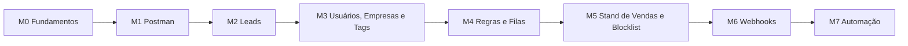

# Curso — API C2S na prática com Postman

São 8 módulos e 46 aulas. O curso leva o analista de Suporte do zero até testar, simular e diagnosticar qualquer chamada da API C2S no Postman. Os Módulos 0 e 1 (Fundamentos e Postman) são só leitura. Do Módulo 2 em diante, as aulas são práticas: cada endpoint tem o passo a passo no Postman, com Leads no centro. Tags, interações, status e venda ficam em aulas curtas e escritas dentro do módulo de Leads. A referência rápida continua em `00-referencia-api.md`.

## Como cada aula é organizada

| Bloco | O que traz |
| --- | --- |
| Objetivo | O que você sabe fazer ao terminar |
| Conceito | Para que serve e quando o cliente usa |
| Passo a passo no Postman | Cliques numerados, para repetir no seu Postman |
| Body e resposta | JSON pronto para copiar |
| Exercício | Prática para fixar |
| No suporte | Como o assunto aparece num ticket |
| Questionário | 4 questões no final da aula. Acerte 3 para concluir. Se errar, as questões são embaralhadas para a nova tentativa |

## Trilha

Faça os módulos em ordem: cada um reaproveita variáveis e requests criados no anterior. Cada módulo termina com um **teste de 10 questões**: é preciso acertar 7 para liberar o próximo módulo. O teste abre quando todos os questionários das aulas do módulo estiverem aprovados.

## Grade curricular

| Módulo | Arquivo | Aulas | Endpoints |
| --- | --- | --- | --- |
| M0 · Fundamentos de API | `M00-fundamentos.md` | 4 | — (teoria) |
| M1 · Introdução ao Postman | `M01-postman-do-zero.md` | 4 | `GET /me` |
| M2 · Leads | `M02-leads.md` | 11 | `GET /leads`, `GET /leads/:id`, `POST /leads`, `PUT /leads/:id`, `PATCH /leads/:id/forward`, `create_tag`, `create_message`, `create_activity`, `update_status`, `done_deal` |
| M3 · Usuários, Empresas e Tags | `M03-cadastros-apoio.md` | 7 | `/me`, `/companies`, `/sellers`, `/tags` |
| M4 · Regras e Filas de Distribuição | `M04-distribuicao.md` | 7 | `/distribution_rules`, `/distribution_queues/...` |
| M5 · Stand de Vendas e Blocklist | `M05-plantao-blocklist.md` | 5 | `/sales_stand/...`, `/hierarchy_blocklists` |
| M6 · Webhooks | `M06-webhooks.md` | 4 | `/api/subscribe`, `/api/unsubscribe` |
| M7 · Automação e diagnóstico | `M07-automacao-diagnostico.md` | 4 | Collection Runner, roteiro de testes + prova final |

## Antes de começar

- [x] Postman instalado e com conta criada
- [x] Token de uma **conta de teste** para os exercícios do curso
- [x] Aba de referência lida uma vez, para ter a visão geral

## Convenções

- `{{base_url}}` e `{{token}}` são as variáveis do Postman configuradas na Aula 1.3. Os IDs (de lead, vendedor, tag, fila) você copia da resposta de uma aula e cola na seguinte. A exceção é o Collection Runner (Aula 7.1), em que scripts salvam os IDs sozinhos.
- Atalhos: `Ctrl+Enter` envia, `Ctrl+S` salva, `Ctrl+D` duplica a request (no Mac, `Cmd`).
