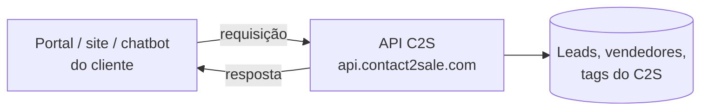

# Módulo 0 — Fundamentos de API

Antes de abrir o Postman, este módulo dá o vocabulário que o resto do curso usa: método, URL, header, body, JSON e status.

## Aula 0.1 — O que é uma API e como o C2S a utiliza

**Leitura:** 6 min

**Objetivo:** explicar a um cliente, em uma frase, o que a API do C2S faz e quando ele precisa dela.

### Conceito

Uma API é uma “porta de serviço” do C2S para outros sistemas. Pela tela, uma pessoa cria um lead clicando. Pela API, um sistema cria o mesmo lead enviando uma mensagem em texto para um endereço na internet.

Analogia: pense no C2S como um banco. A tela é o atendimento na agência: você explica o que quer, e o funcionário entende mesmo se você falar de um jeito diferente. A API é o caixa eletrônico: qualquer um faz a operação sozinho, mas precisa do cartão certo e tem de seguir o menu exatamente como a máquina espera. No fim, a máquina sempre responde: um comprovante quando dá certo, ou uma mensagem de erro dizendo o que falhou.

**Como isso funciona na API.** Na tela do C2S, o vendedor preenche um formulário e a própria tela ajuda: mostra os campos, avisa o que falta e aceita pequenas variações. Pela API não existe ninguém para interpretar. O sistema do cliente (site, portal, chatbot) manda um pedido pela internet e o C2S só executa se o pedido vier completo e no formato combinado:

1. **O cartão é o token.** Ele vai no header `Authorization` de toda chamada e diz de qual empresa é o pedido. Token errado ou vencido é como cartão bloqueado: a API recusa com **403** antes de olhar o resto.
2. **O menu é o endpoint e o método.** Para criar um lead, o sistema escolhe a “opção” `POST /leads`. Para consultar, `GET /leads`. Escolher a opção errada é como apertar “saldo” querendo sacar: a máquina faz outra coisa ou devolve erro.
3. **Os dados digitados são o JSON.** Nome, telefone e e-mail do lead vão num texto em formato fixo, com os campos no lugar que a API espera. Se faltar algo obrigatório, como telefone ou e-mail, a API responde **423**, do mesmo jeito que o caixa pede “preencha o valor”.
4. **O comprovante é a resposta.** Quando dá certo, a API devolve **200** ou **201** e um JSON com o resultado, por exemplo o `lead_id` e o vendedor que recebeu o lead. Quando dá errado, devolve o código e uma mensagem com o motivo.

Resumindo:

| No caixa eletrônico | Na API do C2S |
| --- | --- |
| Cartão e senha | Token (header `Authorization`) |
| Menu na ordem que a máquina espera | Endpoint, método e JSON no formato certo |
| Comprovante | Resposta com status 200 ou 201 |
| “Senha inválida” | Erro 403 |
| “Preencha o valor” | Erro 423: faltou telefone ou e-mail no lead |

Quase todo caso de API no Suporte é descobrir qual dessas linhas falhou.



O sistema do cliente faz a pergunta; a API lê ou grava no C2S e responde.

### Quem usa a API do C2S

| Cenário real | O que o sistema do cliente faz | Endpoint |
| --- | --- | --- |
| Site próprio com formulário | Cria um lead a cada envio | `POST /leads` |
| Chatbot de WhatsApp | Cria o lead e grava a conversa | `POST /leads`, `create_message` |
| BI ou planilha de gestão | Puxa leads do período | `GET /leads` |
| ERP ou sistema de vendas | Marca venda fechada | `done_deal` |
| Sistema que precisa reagir a lead novo | Recebe aviso automático | Webhook `on_create_lead` |

### Glossário

- **Endpoint:** um endereço específico da API, ex.: `/leads`.
- **Requisição (request):** o pedido que sai do Postman.
- **Resposta (response):** o que a API devolve.
- **Token:** a senha do sistema; prova que a chamada vem de uma empresa autorizada.
- **Integração:** o sistema do cliente conversando com o C2S pela API.

### No suporte

Quando um cliente diz “a integração não funciona”, quase sempre a pergunta real é uma destas: o pedido chegou? Estava no formato certo? O token vale? O curso inteiro treina você a responder as três no Postman.

### Exercício

Escreva em uma frase, para um cliente leigo, a diferença entre cadastrar um lead pela tela e pela API.

## Aula 0.2 — Anatomia de uma requisição HTTP

**Leitura:** 8 min

**Objetivo:** olhar qualquer chamada e identificar método, URL, headers e body.

### Partes de uma requisição

| Parte | O que é | Exemplo C2S | Onde fica no Postman |
| --- | --- | --- | --- |
| Método | A ação desejada | `POST` | Menu à esquerda da URL |
| URL | O endereço do recurso | `https://api.contact2sale.com/integration/leads` | Barra de endereço |
| Headers | Informações extras, como o token | `Authorization: Bearer abc123...` | Abas *Authorization* e *Headers* |
| Body | Os dados enviados | `{ "data": { ... } }` | Aba *Body* |

### Os métodos da API C2S

| Método | Significado | Altera dados? | Exemplo |
| --- | --- | --- | --- |
| GET | Consultar | Não | Listar leads |
| POST | Criar ou executar uma ação | Sim | Criar lead, mudar status |
| PUT | Atualizar um registro | Sim | Atualizar lead ou vendedor |
| PATCH | Atualizar parte de um registro | Sim | Transferir lead |

Regra prática: GET é sempre seguro para testar com o cliente em linha. Os outros métodos gravam dados.

### Partes de uma URL

`https://api.contact2sale.com/integration/leads/a1b2c3.../tags?page=1`

1. `https://api.contact2sale.com` — o servidor.
2. `/integration` — a entrada da API de integração (vai para a variável `{{base_url}}`).
3. `/leads` — o recurso.
4. `/a1b2c3...` — o **path param**: qual lead. Na documentação aparece como `:id`.
5. `/tags` — a sub-ação sobre esse lead.
6. `?page=1` — o **query param**: filtros e opções, sempre depois do `?` e separados por `&`.

### Headers usados no C2S

- `Authorization: Bearer <token>` — obrigatório em todas as chamadas.
- `Content-Type: application/json` — obrigatório quando há body. O Postman coloca sozinho quando você escolhe *raw / JSON*.

### Passo a passo (sem enviar nada)

1. Abra o Postman e clique em **+** para abrir uma aba nova.
2. Veja o menu de método e troque entre GET, POST, PUT e PATCH.
3. Cole a URL de exemplo acima e veja que a aba **Params** se preenche sozinha com `page = 1`.
4. Veja as abas **Authorization**, **Headers** e **Body** e identifique qual parte da tabela cada uma representa.
5. Clique no ícone **</>** (Code) na barra lateral direita e veja a mesma requisição escrita como cURL. É o formato que o time de Dev costuma pedir.

### Exercício

Para a chamada `PATCH {{base_url}}/leads/XYZ/forward`, diga o método, o recurso, o path param e se ela altera dados.

## Aula 0.3 — Formato JSON

**Leitura:** 8 min

**Objetivo:** ler e escrever um JSON válido e achar o erro num JSON quebrado.

### Conceito

JSON é o formato de texto que a API C2S usa para receber e devolver dados. É uma lista de pares **chave: valor** entre chaves.

```json
{
  "name": "Pedro Silva",
  "channel_id": 1,
  "pending": false,
  "tags": ["quente", "retorno"],
  "customer": { "email": "pedro@exemplo.com" },
  "observation": null
}
```

| Tipo | Exemplo | Regra |
| --- | --- | --- |
| Texto (string) | `"Pedro Silva"` | Sempre entre aspas duplas |
| Número | `1`, `250000` | Sem aspas |
| Booleano | `true`, `false` | Sem aspas, minúsculo |
| Lista (array) | `["a", "b"]` | Colchetes, itens separados por vírgula |
| Objeto | `{ "email": "..." }` | Chaves; pode ficar dentro de outro objeto |
| Vazio | `null` | Sem aspas |

### Erros comuns de JSON

1. Vírgula depois do último item: `"source": "site",}`.
2. Aspas simples ou “aspas curvas” copiadas do Word/WhatsApp em vez de `"`.
3. Chave sem aspas: `name: "Pedro"`.
4. Chave ou colchete sem fechar.
5. Número como texto quando a API espera número: `"status": "3"` em vez de `"status": 3`.

### Aninhamento no `POST /leads`

Na API C2S, criar lead exige os campos **dentro** de `data → attributes`. Leia de fora para dentro:

```json
{
  "data": {
    "type": "lead",
    "attributes": {
      "name": "Pedro Silva",
      "phone": "11999999999"
    }
  }
}
```

Já o `PUT /leads/:id` usa outra casca: `{ "lead": { ... } }`. Metade dos erros de integração é casca errada.

### Passo a passo

1. No Postman, abra uma aba nova, método **POST**, aba **Body** → **raw** → **JSON**.
2. Cole o JSON acima e veja o realce de cores: chaves, textos e números ficam com cores diferentes.
3. Apague uma aspa e veja o sublinhado vermelho do Postman apontando o erro.
4. Coloque uma vírgula sobrando e veja o aviso de novo.
5. Clique em **Beautify** (no canto do Body) para reorganizar o JSON indentado.

### Exercício

Ache os 3 erros: `{ name: "Ana", 'phone': "1199", "channel_id": "1", }`

Resposta: chave sem aspas, aspas simples, vírgula sobrando. Bônus: `channel_id` deveria ser número.

## Aula 0.4 — Códigos de status HTTP

**Leitura:** 6 min

**Objetivo:** olhar o número da resposta e saber, em segundos, de quem é o problema.

### Conceito

Toda resposta traz um código de 3 dígitos. O primeiro dígito já diz muito:

| Família | Significa | De quem é o problema |
| --- | --- | --- |
| 2xx | Deu certo | Ninguém |
| 4xx | O pedido veio errado | De quem chamou (token, URL, body) |
| 5xx | O servidor falhou | Do C2S: caso de escalar |

### Códigos que a API C2S devolve

| Código | No C2S significa | Primeira ação |
| --- | --- | --- |
| 200 / 201 | Sucesso | Conferir IDs na resposta |
| 400 | JSON quebrado ou body sem a casca `data` | Validar o JSON e a casca |
| 401 | Campo obrigatório vazio (ex.: `message` em Atualizar Status) | Ler a mensagem e completar o body |
| 403 | Token inválido: `{"error":"access_denied"}`, ou parâmetro inválido: `{"success":false,"message":"..."}` | Ler a mensagem; testar `GET /me` |
| 404 | URL ou ID não existe, ou lead fora do alcance do token | Conferir caminho, `{{base_url}}` e o ID |
| 409 | Registro já existe (blocklist) | Consultar antes de criar |
| 422 | Dado que não confere ou registro repetido (ex.: vendedor de origem errado, tag inexistente, usuário já cadastrado) | Ler a mensagem e corrigir o dado |
| 423 | Lead sem telefone e sem e-mail | Enviar ao menos um |
| 429 | Passou de 10 chamadas por minuto no mesmo endpoint | Esperar 1 minuto |
| 500 | Erro no servidor (ex.: body fora de UTF-8) | Conferir o body; se persistir, escalar |

### Passo a passo

1. Veja onde o Postman exibe o status: no topo da área de resposta, junto com **tempo** (ms) e **tamanho**.
2. Passe o mouse sobre o código para ver a descrição que o Postman mostra.
3. Envie qualquer chamada sem token e veja o **403** na prática (isso será feito de verdade na Aula 1.4).

### No suporte

Peça ao cliente o código e o corpo da resposta antes de qualquer outra coisa. Com 4xx, o caso quase nunca precisa de escalonamento.
