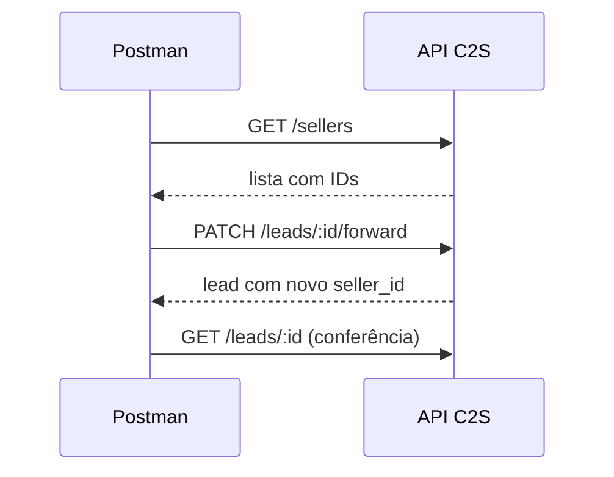

# Módulo 2 — Leads

O módulo mais usado no dia a dia do Suporte. Começa pelas consultas (GET), que não alteram nada, passa pela criação e edição do lead e termina com tags, interações, status e venda em aulas curtas e escritas.

A partir da Aula 2.5 as chamadas escrevem dados: use sempre o token da conta de teste.

## Aula 2.1 — `GET /leads`: Listar Leads

**Prática:** 8 min
**Objetivo:** listar os leads da conta e entender a estrutura da resposta.

### Conceito

`GET /leads` devolve os leads da empresa do token, em páginas de até 50. Sem filtros, traz os mais recentes. É o endpoint que BIs, planilhas e sistemas de gestão usam para “puxar” dados do C2S.

### Passo a passo

1. Pasta `Leads` → *Add request* → `GET /leads — Listar Leads`.
2. Método **GET**, URL `{{base_url}}/leads`.
3. Aba **Params** → adicione:

| Key | Value | Por quê |
| --- | --- | --- |
| `perpage` | `5` | Resposta curta, fácil de ler |
| `sort` | `-created_at` | Mais novos primeiro |

4. Repare que a URL virou `{{base_url}}/leads?perpage=5&sort=-created_at` sozinha.
5. **Send**.
6. Na resposta, use a aba **Pretty** e clique nas setas para recolher/expandir os objetos. Veja:
    - a lista de leads, cada um com seu `id` criptografado;
    - dados do cliente, vendedor, status e tags de cada lead;
    - o objeto `meta` no final, com o `total` de leads.
7. Clique no ícone de lupa (*Search*) da área de resposta e procure um nome para achar um lead específico.

### Guardar um ID

Copie o `id` de um lead da lista (o texto longo, não o `internal_id`) e deixe anotado: as próximas aulas pedem esse ID.

A lista vem sempre em `data` e o total em `meta.total` (a doc oficial fala em `pagination`, mas a resposta real não traz esse objeto).

### Salvar um exemplo

Depois do Send, clique em **Save Response** → **Save as example**. O exemplo fica guardado na collection e serve de gabarito para comparar com o que o cliente recebe.

### Exercício

Mude `sort` para `created_at` (sem o `-`) e confirme que agora vem o lead mais antigo primeiro.

## Aula 2.2 — `GET /leads`: Listar Leads · filtros e buscas

**Prática:** 10 min
**Objetivo:** achar um lead específico por telefone, e-mail, data, status ou tag.

### Conceito

Os filtros vão na URL como *query params*. Você pode combiná-los: todos precisam ser verdadeiros ao mesmo tempo.

| Parâmetro | Tipo | Exemplo |
| --- | --- | --- |
| `phone` | texto | `11999999999` |
| `email` | texto | `pedro@exemplo.com` |
| `created_gte` | data em UTC com Z | `2026-09-01T03:00:00Z` |
| `created_lt` | data em UTC com Z | `2026-09-02T03:00:00Z` |
| `updated_gte` / `updated_lt` | data ISO 8601 | Mesmo formato |
| `status` | texto | `novo` (também `em_negociacao`, `convertido`, `negocio_fechado`, `arquivado`, `resgatado`, `pendente`, `recusado`, `finalizado`) |
| `tags` | texto, vírgulas | `quente,retorno` |
| `from_hierarchy_company` | booleano | Hoje com erro na API: não use (veja a Busca D) |

`gte` = maior ou igual (a partir de). `lt` = menor que (antes de). Juntos formam um intervalo que não repete o dia seguinte.

### Passo a passo — buscas mais comuns

Duplique a request da Aula 2.1 (`Ctrl+D`) para cada busca e salve com nomes claros.

**Busca A — “o lead do cliente Pedro chegou?”**

1. Params: `phone = 11999999999`. Desmarque o `perpage` se quiser.
2. Send. Lista vazia = o lead não existe nesta empresa.
3. Teste variações do número (com e sem DDI 55) e anote qual formato retorna.

**Busca B — “quantos leads entraram ontem?”**

1. Params: `created_gte = 2026-09-22T03:00:00Z` e `created_lt = 2026-09-23T03:00:00Z` (meia-noite de Brasília = 03:00 em UTC).
2. Send e leia `meta.total`.
3. **O filtro de data só aceita UTC com `Z`.** Com `-03:00` ou só a data, a API devolve **403** `invalid date or strptime format`.

**Busca C — leads novos com a tag quente**

1. Params: `status = novo` e `tags = quente`. O filtro `tags` usa o **nome** da tag.

**Busca D — de qual unidade veio o lead**

1. Pela doc, `from_hierarchy_company = true` acrescenta a cada lead o nome da empresa que **gerou** o lead.
2. **Na prática, o parâmetro dá erro** quando a página inclui um lead criado pela API: **403** `undefined method 'gsub' for true`. Com leads criados pela tela ele funciona, mas o resultado muda conforme a página. Não use nem oriente o cliente a usar.

### Erros comuns

- Data sem fuso ou em formato brasileiro (`22/09/2026`): use sempre ISO 8601.
- Espaço ou `+` no telefone dentro da URL: o `+` vira espaço. Envie só dígitos.
- Tag com acento ou espaço: o Postman codifica, mas confira o nome exato com `GET /tags` (Aula 3.6).

### No suporte

“O lead do portal não chegou”: rode a Busca A com o telefone e a Busca B com o horário do envio. Se não aparecer, o portal nem chamou a API (ou chamou com erro). Peça o log do portal.

O filtro `phone` acha o lead **com ou sem o 55** (`5511999999999` ou `11999999999`), mas não acha por parte do número: `999999999` não traz nada.

## Aula 2.3 — `GET /leads`: Listar Leads · paginação

**Prática:** 8 min
**Objetivo:** explicar por que o cliente “só recebe 50 leads” e mostrar como percorrer todas as páginas.

### Conceito

A API nunca devolve tudo de uma vez: no máximo **50 por página** (`perpage=80` dá 403 `must be less than or equal to 50`). A resposta traz só o total, em `meta.total`. As páginas você calcula:

| O quê | Onde / como | Exemplo |
| --- | --- | --- |
| Total de leads | `meta.total` no body | `230` |
| Total de páginas | `meta.total ÷ perpage`, arredondando para cima | `230 ÷ 50 = 5` |
| Fim da lista | Uma página além da última devolve `data: []` | `page=6` |

A doc oficial fala em `pagination.total_pages` e em headers de paginação, mas a API real não devolve nenhum dos dois.

### Passo a passo

1. Duplique `GET /leads — Listar Leads` → `GET /leads — Listar Leads (paginação)`.
2. Params: `perpage = 50`, `page = 1`, e um intervalo de datas (Aula 2.2).
3. Send → anote `meta.total` e calcule o total de páginas.
4. Mude para `page = 2` → Send → leads diferentes.
5. Peça uma página além da última (ex.: `page = 99`) → lista vazia. É o sinal de fim.

### No suporte

“A API só me devolve 50 leads” não é bug: o sistema do cliente precisa ler `meta.total`, calcular as páginas e repetir a chamada, respeitando o limite de 10 chamadas por minuto.

## Aula 2.4 — `GET /leads/:id`: Buscar Lead por ID

**Prática:** 7 min
**Objetivo:** abrir um lead pelo ID e ler mensagens, atividades e tags.

### Conceito

A lista traz um resumo; o detalhe traz tudo sobre **um** lead: cliente, vendedor, mensagens, atividades agendadas e tags. O `:id` é o ID criptografado que veio da lista ou da criação, **não** o número que aparece na tela do C2S.

### Passo a passo

1. Pasta `Leads` → `GET /leads/:id — Buscar Lead por ID`.
2. URL: `{{base_url}}/leads/:id`.
3. Repare que a aba **Params** criou a seção **Path Variables** com a key `id`. Em *Value*, cole o ID de um lead (da Aula 2.1 ou o `lead_id` da Aula 2.5).
4. Send.
5. Percorra a resposta:
    - dados do cliente (nome, telefone, e-mail);
    - vendedor responsável;
    - `messages`: histórico de conversa;
    - `schedulated_actions`: atividades agendadas;
    - tags.
6. Não use `from_hierarchy_company = true` aqui: em leads criados pela API ele devolve **401** com erro interno.

### Por que Path Variable e não colar o ID na URL?

Com `:id` + Path Variable, a request salva fica genérica. Basta trocar o valor em *Path Variables* para abrir outro lead, sem editar a URL.

### Erros comuns

| Sintoma | Causa |
| --- | --- |
| 404 | ID digitado da tela (número) em vez do criptografado |
| 404 | Lead de outra empresa do grupo: use o token da empresa que recebeu o lead |
| URL com `:id` literal | Path Variable sem valor |

### Exercício

Use a Busca A da Aula 2.2 para achar um lead pelo telefone, copie o `id` dele para `lead_id` (botão direito → *Set*) e abra o detalhe.

## Aula 2.5 — `POST /leads`: Criar Lead

**Prática:** 12 min
**Objetivo:** criar um lead pela API, entender cada parte da resposta e salvar o ID automaticamente.

### Conceito

É o endpoint mais importante do curso: **toda integração de portal, site ou chatbot termina aqui**. A API recebe os dados, cria o lead, aplica as regras de distribuição e devolve quem recebeu.

Duas regras que resolvem a maioria dos erros:

1. Os campos vão **dentro de** `data → attributes` (só este endpoint usa essa casca).
2. **Telefone ou e-mail é obrigatório.** Sem nenhum dos dois, a API devolve **423**.

### Passo a passo

1. Pasta `Leads` → `POST /leads — Criar Lead`.
2. Método **POST**, URL `{{base_url}}/leads`.
3. Aba **Body** → **raw** → menu à direita **JSON**.
4. Cole o corpo mínimo:

```json
{
  "data": {
    "type": "lead",
    "attributes": {
      "name": "Teste Curso Suporte",
      "phone": "11999990000",
      "body": "Lead de teste criado pelo Postman",
      "source": "curso_suporte"
    }
  }
}
```

5. Aba **Headers**: veja que o Postman adicionou `Content-Type: application/json` sozinho (header oculto).
6. **Send**.
7. Leia a resposta:

```json
{
  "success": true,
  "lead_id": "a1b2c3d4e5f6a7b8c9d0e1f2a3b4c5d6",
  "received_by": { "id": "...", "name": "Maria Vendedora", "email": "maria@exemplo.com" },
  "company": "Empresa Exemplo",
  "info": { "name": "Teste Curso Suporte", "phone": "5511999990000", "channel_id": 1 }
}
```

| Campo da resposta | O que responde |
| --- | --- |
| `success` | Deu certo? |
| `lead_id` | ID do lead criado, para as próximas chamadas |
| `received_by` | Qual vendedor recebeu (distribuição aplicada) |
| `company` | Em qual empresa o lead caiu |
| `info` | Como a API interpretou os dados (o telefone volta como você enviou) |

8. Abra o C2S na conta de teste e veja o lead aparecendo na tela, com o vendedor de `received_by`.

### Guardar os IDs

Copie da resposta o `lead_id` e o `received_by.id` (vendedor que recebeu). As próximas aulas usam os dois.

### Dados diferentes a cada envio

Para não criar sempre o mesmo cliente, use variáveis dinâmicas do Postman no body:

```json
"name": "{{$randomFullName}}",
"email": "{{$randomEmail}}",
"external_id": "{{$guid}}"
```

### Testando os erros

| Teste | Resultado esperado |
| --- | --- |
| Remova `phone` (e não tenha `email`) | 423 |
| Tire a casca `data` e mande os campos direto na raiz | **400** `param_data_not_found`; lead não criado |
| Deixe uma vírgula sobrando | **400** sem corpo na resposta: o JSON está quebrado |
| Troque o token por `123` | 403 |

### No suporte

Peça ao cliente o body exato que o sistema dele envia e cole no Postman. Se funcionar com o seu token de teste, o problema está no token dele ou no envio (URL, header).

## Aula 2.6 — `POST /leads`: Criar Lead · variações por tipo de cliente

**Prática:** 12 min
**Objetivo:** montar o body certo para imobiliária, revenda de veículos e chatbot de WhatsApp.

### Conceito

O mesmo endpoint atende segmentos diferentes. O que muda são os campos de produto dentro de `attributes`.

### Variação A — Imobiliária

```json
{
  "data": {
    "type": "lead",
    "attributes": {
      "name": "Pedro Silva",
      "email": "pedro@exemplo.com",
      "phone": "11999999999",
      "prop_ref": "AP12345",
      "description": "Apartamento 2 quartos",
      "price": "R$ 250.000,00",
      "type_negotiation_string": "Comprar",
      "city": "Campinas",
      "neighbourhood": "Botafogo",
      "url": "https://portal.exemplo.com/imovel/AP12345",
      "channel_id": 1,
      "source": "portal_zap",
      "body": "Olá, tenho interesse no imóvel."
    }
  }
}
```

`prop_ref` liga o lead ao imóvel cadastrado. Sem ele, o lead chega sem anúncio vinculado. Para empresas do tipo imobiliária ele é obrigatório. Se o cliente não tiver o código, a API aceita os valores especiais `Sem código`, `Não localizado`, `Nenhum` ou `ignore`.

### Variação B — Revenda de veículos

```json
{
  "data": {
    "type": "lead",
    "attributes": {
      "name": "Ana Souza",
      "phone": "11988887777",
      "brand": "Toyota",
      "model": "Corolla",
      "version": "XEi 2.0",
      "year": 2022,
      "color": "Prata",
      "km": 35000,
      "license_plate": "ABC1D23",
      "price": "115000",
      "vehicle_type": "Usado",
      "channel_abbrev": "internet",
      "body": "Ainda está disponível?"
    }
  }
}
```

### Variação C — Chatbot de WhatsApp

```json
{
  "data": {
    "type": "lead",
    "attributes": {
      "name": "Carlos Lima",
      "phone": "5511977776666",
      "channel_abbrev": "whatsapp",
      "source": "chatbot",
      "body": "Quero saber mais sobre o lançamento",
      "already_interacted": true,
      "tags": ["<ID da tag>"]
    }
  }
}
```

`already_interacted: true` avisa que o bot já conversou com o cliente.

### Campos opcionais úteis

| Campo | Uso |
| --- | --- |
| `external_id` | ID do lead no sistema de origem; ajuda a achar duplicidades |
| `custom_created_at` | Importar lead antigo com a data original (ISO 8601) |
| `observation` | Nota interna, não aparece como mensagem do cliente |
| `real_state_keywords` | Palavras usadas nas regras de distribuição |
| `pending`, `closed` | Criar o lead já pendente ou fechado |
| `description` | Máx. 250 caracteres |
| `body` | Máx. 15.000 caracteres, aceita HTML |

### Passo a passo

1. Duplique `POST /leads — Criar Lead` três vezes: `… imobiliária`, `… veículo`, `… whatsapp`.
2. Cole cada body, **Send** e confira `received_by` em cada um.
3. Abra cada lead no C2S e veja onde cada campo aparece na tela.
4. Salve cada resposta como *example*.

### Deduplicação

Envie a Variação A duas vezes com o mesmo e-mail e compare os `lead_id`. O e-mail é deduplicado automaticamente, e a API remove os pontos antes do `@`: `pedro.silva@` e `pedrosilva@` contam como o mesmo e-mail.

O `channel_id` vai de 1 a 5, com 1 = Internet (padrão) e 2 = Showroom. Para os demais, confira o nome do canal na tela do lead depois de criar. Em veículos, `year` e `km` são números e `vehicle_type` aceita `Novo` ou `Usado`.

## Aula 2.7 — `PUT /leads/:id`: Atualizar Lead

**Prática:** 8 min
**Objetivo:** corrigir dados de cliente e produto de um lead existente.

### Conceito

`PUT` altera um lead que já existe. A casca muda em relação ao POST: aqui é `{ "lead": { ... } }`, com sub-objetos `customer` (cliente) e `product` (produto).

| Casca | Endpoint |
| --- | --- |
| `data → attributes` | `POST /leads` (criar) |
| `lead → customer / product` | `PUT /leads/:id` (atualizar) |

### Passo a passo

1. Tenha em mãos o `lead_id` criado na Aula 2.5.
2. Pasta `Leads` → `PUT /leads/:id — Atualizar Lead`.
3. Método **PUT**, URL `{{base_url}}/leads/:id`, Path Variable `id` = o `lead_id`.
4. Body raw / JSON:

```json
{
  "lead": {
    "customer": {
      "name": "Teste Curso Suporte (corrigido)",
      "email": "teste.curso@exemplo.com"
    },
    "product": {
      "brand": "Toyota",
      "model": "Corolla"
    }
  }
}
```

5. **Send** → a resposta traz o lead atualizado com os novos timestamps.
6. Rode de novo `GET /leads/:id — Buscar Lead por ID` (Aula 2.4) e veja os dados novos. É o hábito de **conferir com um GET depois de todo PUT**.

Outros campos aceitos dentro de `lead`: `channel_id`, `lead_source_id`, `url`, `type_negotiation`, `body`.

### Erros comuns

- Mandar o body do POST (`data → attributes`) no PUT: a API ignora ou dá erro.
- Esquecer o `:id` preenchido: vira 404.

## Aula 2.8 — `PATCH /leads/:id/forward`: Encaminhar Lead

**Prática:** 8 min
**Objetivo:** passar um lead de um vendedor para outro pela API.

### Conceito

Transferir exige dois IDs de vendedor: **de quem sai** e **para quem vai**. Os dois são IDs criptografados que vêm de `GET /sellers` (Aula 3.2) ou do `received_by` da criação.



Sempre três chamadas: descobrir IDs, transferir, conferir.

### Passo a passo

1. Rode `GET /sellers` (pasta `Usuários`, Aula 3.2; se ainda não criou, crie agora: GET `{{base_url}}/sellers`).
2. Escolha um vendedor diferente do atual e copie o `id` dele.
3. O vendedor atual é o `received_by.id` da criação (Aula 2.5) ou o `seller.id` em Buscar Lead por ID (Aula 2.4).
4. Nova request `PATCH /leads/:id/forward — Encaminhar Lead`, método **PATCH**, URL `{{base_url}}/leads/:id/forward`, Path Variable `id` = o `lead_id`.
5. Body:

```json
{
  "seller_from_id": "<ID do vendedor atual>",
  "seller_to_id": "<ID do novo vendedor>"
}
```

6. **Send** → a resposta traz `success: true` e o lead com o novo `seller_id`. Esse `seller_id` é o número interno do vendedor, não o ID criptografado.
7. Confira no `GET /leads/:id` e na tela do C2S.

### Erros comuns

| Sintoma | Causa |
| --- | --- |
| 422 `seller_from id not match` | `seller_from_id` não é o dono atual do lead |
| Erro de validação | ID de vendedor da tela em vez do criptografado |
| Nada muda | Mesmo vendedor em “de” e “para” |

### Exercício

Transfira o lead para um vendedor e depois devolva ao original, trocando os dois IDs de lugar no body.

Repetir a mesma transferência dá **422** `{"messages":["seller_from id not match"]}`, porque o dono já mudou.

## Aula 2.9 — Listar Tags do Lead, Adicionar Tag ao Lead e Remover Tag do Lead

**Leitura:** 5 min

**Objetivo:** Aplicar e remover tags de um lead usando o ID da tag.

### Como funciona

Os três endpoints trabalham com o **ID da tag**, nunca com o nome. Pegue o ID com `GET /tags` ou crie a tag com `POST /tags` (Aulas 3.6 e 3.7).

| Ação | Endpoint | Body |
| --- | --- | --- |
| Ver as tags do lead | `GET /leads/:id/tags` | sem body |
| Adicionar | `POST /leads/:id/create_tag` | `{ "tag_id": "<ID da tag>" }` |
| Remover | `POST /leads/:id/remove_tag` | `{ "tag_id": "<ID da tag>" }` ou uma lista `{ "tag_id": ["id1", "id2"] }` |

- `GET /leads/:id/tags` devolve só IDs numéricos internos (`tag_id: 70001`), **sem o nome** da tag. Para saber o nome, compare com Listar Tags.
- Enviar o nome no lugar do ID dá **422** `tag not found, please create one`.
- Remover também é **POST**. Na API C2S, ações sobre o lead são POST em sub-caminhos (`/leads/:id/<ação>`).
- Na resposta de `create_tag`, os IDs aparecem como números internos (ex.: `tag_id: 48437`), diferentes do ID criptografado que você enviou.
- Depois de adicionar ou remover, confira com `GET /leads/:id/tags`.

### No suporte

“A tag não aplica”: quase sempre o sistema do cliente manda o **nome** da tag em vez do ID, ou uma tag de outra empresa do grupo. Confira com `GET /tags` usando o token da empresa do lead.

## Aula 2.10 — Marcar Lead como Lido, Criar Mensagem no Lead e Criar Atividade no Lead

**Leitura:** 6 min

**Objetivo:** Saber quais endpoints chatbots e automações usam para registrar o atendimento no lead.

### Como funciona

| Endpoint | Para que serve | Body mínimo |
| --- | --- | --- |
| `POST /leads/:id/mark_as_interacted` | Tira o lead de “não lido” quando o atendimento aconteceu fora do C2S | sem body |
| `POST /leads/:id/create_message` | Grava uma mensagem no histórico do lead | `body`, `from`, `origin` |
| `POST /leads/:id/create_activity` | Agenda um lembrete para o vendedor | `date`, `type`, `body` |

Mensagem de chatbot:

```json
{
  "body": "Olá! Qual imóvel te interessou?",
  "from": "bot",
  "origin": "whatsapp",
  "message_type": "text",
  "sender_name": "Assistente Virtual",
  "created_at": "{{$isoTimestamp}}"
}
```

Atividade com notificação para o vendedor:

```json
{
  "date": "2026-12-01T14:00:00-03:00",
  "type": { "activity": true },
  "body": "Ligar para confirmar visita",
  "send_push": true,
  "title": "Retorno ao cliente"
}
```

### Cuidados

- `mark_as_interacted` devolve o `read_at` dentro de `lead`: `{ "success": true, "lead": { "read_at": "..." } }`. Se o lead já tinha sido lido, o `read_at` **mantém a data da primeira leitura**; a nova marcação aparece só no histórico.
- Em `create_activity`, `type` é um objeto (`{ "activity": true }`), não um texto. A data precisa de fuso (`-03:00`), senão a atividade aparece deslocada.
- A atividade aparece em `schedulated_actions` do lead, com essa grafia da própria API.

Use `from: "bot"` para mensagens do robô e `from: "customer"` para as do cliente, com `message_type: "text"`. No histórico do lead, as duas aparecem com remetente “SysUser”.

### No suporte

“As mensagens do chatbot não aparecem no lead”: confira se o bot usa o `lead_id` criptografado devolvido na criação (Aula 2.5) e se envia o campo `body`.

## Aula 2.11 — Atualizar Status do Lead e Fechar Negócio do Lead

**Leitura:** 6 min

**Objetivo:** Marcar um lead como perdido ou registrar a venda pela API.

### Como funciona

| Ação | Endpoint | Body |
| --- | --- | --- |
| Mudar status | `POST /leads/:id/update_status` | `{ "status": 3, "message": "Cliente não tem interesse", "lost_reason_ids": [12] }` |
| Registrar venda | `POST /leads/:id/done_deal` | `{ "prop_ref": "AP12345", "done_type_negotiation": "sale", "info": "Venda à vista", "date": "2026-09-23", "value": "250000" }` |

| `status` | Alias | Significado |
| --- | --- | --- |
| 0 | `new` | Novo |
| 1 | `under_negotiation` | Em negociação |
| 2 | `converted` | Negócio fechado |
| 3 | `lost` | Perdido / arquivado (na tela aparece como “Arquivado”) |

O `update_status` responde **201** e traz `data.attributes.lead_status`, com `id`, `alias` e `name`. O campo **`message` é obrigatório**: sem ele a API devolve 401 `Message cannot be empty`.

O `done_deal` responde 200 com um formato estranho (`{ "success": true, "tags": {...} }`). Para confirmar a venda, abra o lead com Buscar Lead por ID e procure no `log` “Integração marcou como negócio fechado”.

### Erros comuns

- `status` como texto (`"3"` ou `"lost"`): use o número.
- `lost_reason_ids` fora de lista: use `[12]`, não `12`.
- Data do `done_deal` com hora: aqui o formato é só `AAAA-MM-DD`.

Os `lost_reason_ids` são os motivos de perda cadastrados na conta do cliente: confira na tela de configurações do C2S. Para venda, use `done_type_negotiation: "sale"`.

### No suporte

“Meu sistema arquiva e o lead volta”: confira se o sistema do cliente não cria o lead de novo com `POST /leads` logo depois. Busque pelo telefone (Aula 2.2) e compare as datas.
