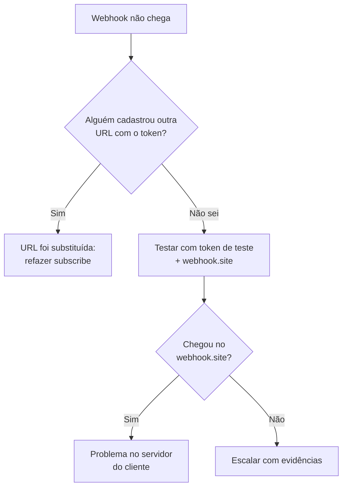

# Módulo 6 — Webhooks

Aqui o sentido se inverte: em vez de você chamar a API, o C2S chama o sistema do cliente.

## Aula 6.1 — O que é um webhook

**Prática:** 7 min
**Objetivo:** explicar a diferença entre consultar a API e receber um webhook.

### Conceito

Até aqui, **você perguntava** e o C2S respondia. Com webhook, o C2S **avisa sozinho**: quando algo acontece, ele faz um POST para uma URL do cliente.

| | Consultar (polling) | Webhook |
| --- | --- | --- |
| Quem inicia | Sistema do cliente | C2S |
| Quando | De tempos em tempos | Na hora do evento |
| Custo | Muitas chamadas vazias | Uma chamada por evento |
| Exemplo | `GET /leads` a cada 5 min | Aviso de lead novo |

Analogia: consultar é ficar ligando para a pizzaria perguntando se a pizza saiu; webhook é a pizzaria mandar mensagem quando ela sai.

**Como isso funciona na API.** “Ficar ligando” é o sistema do cliente chamar `GET /leads` de tempos em tempos, por exemplo a cada 5 minutos, filtrando por data para ver se entrou algo novo. Na maioria das vezes a resposta vem vazia, e cada chamada conta no limite de 10 por minuto. Além disso, o lead pode esperar até 5 minutos para ser visto.

“A pizzaria mandar mensagem” é o webhook. O cliente cadastra uma única vez, com Assinar Webhook (`POST /api/subscribe`), o endereço (`hook_url`) do sistema dele que deve ser avisado. A partir daí, quando um lead é criado, alterado ou fechado, o próprio C2S faz um POST para esse endereço com os dados do lead. O sistema do cliente não pergunta nada: só recebe.

A consequência para o Suporte é que, com webhook, o problema pode estar do lado do cliente. Se o endereço dele estiver fora do ar ou exigir login, a “mensagem da pizzaria” não é entregue, mesmo com o C2S funcionando.

### Eventos disponíveis

| `hook_action` | Dispara quando |
| --- | --- |
| `on_create_lead` | Lead novo entra |
| `on_update_lead` | Um log de alteração é gerado no lead |
| `on_close_lead` | Lead é arquivado ou o negócio é fechado |

### Um endpoint por token

**Um token = um endpoint.** Se alguém cadastrar outra URL com o mesmo token, a anterior é **apagada automaticamente**, sem aviso. Os três eventos podem usar a mesma URL: faça uma inscrição para cada `hook_action`. É a causa mais comum de “meu webhook parou”.

## Aula 6.2 — `POST /api/subscribe`: Assinar Webhook

**Prática:** 10 min
**Objetivo:** inscrever um webhook e ver o payload chegando ao vivo.

### Conceito

Para testar, você precisa de uma URL que receba e veja as chamadas. O [webhook.site](https://webhook.site) cria uma de graça, na hora, sem cadastro.

### Passo a passo

1. Abra [webhook.site](https://webhook.site) numa aba do navegador. Copie a **Your unique URL**.
2. Pasta `Webhooks` → `POST /api/subscribe — Assinar Webhook`.
3. **POST** `{{base_url}}/api/subscribe`.
4. Body:

```json
{
  "hook_action": "on_create_lead",
  "hook_url": "<sua URL do webhook.site>"
}
```

5. **Send** → resposta `{ "success": true, "message": "Subscribed successfully" }`.
6. Rode `POST /leads — Criar Lead` (Aula 2.5).
7. Volte ao webhook.site: à esquerda aparece uma chamada nova. Clique e veja:
    - método e horário da chamada;
    - headers enviados pelo C2S;
    - o **body** em JSON com os dados do lead: é exatamente o que o sistema do cliente recebe.
8. Guarde esse JSON: é o formato que o sistema do cliente recebe. Quando um cliente perguntar “o que chega no meu webhook?”, é ele que você mostra.

O caminho completo `https://api.contact2sale.com/integration/api/subscribe` está confirmado na documentação oficial.

### Alternativa: mock server do Postman

O Postman também cria URLs que recebem chamadas (*Mock servers*). Para o curso, o webhook.site é mais simples porque mostra o body recebido na hora.

## Aula 6.3 — Assinar Webhook: testando os três gatilhos

**Prática:** 8 min
**Objetivo:** provar cada evento com a ação que o dispara.

### Passo a passo

1. Duplique a request de subscribe duas vezes e troque o `hook_action` para `on_update_lead` e `on_close_lead`. Envie as duas com a **mesma** `hook_url`: trocar a URL apaga a inscrição anterior.
2. Dispare cada evento:

| Evento | Ação que dispara (aula) |
| --- | --- |
| `on_create_lead` | `POST /leads` (2.5) |
| `on_update_lead` | `PUT /leads/:id` (2.7) ou `update_status` (2.11) |
| `on_close_lead` | `done_deal` (2.11) ou `update_status` com `status: 3` (2.11) |

3. No webhook.site, veja uma chamada para cada ação e compare os payloads.
4. Anote o tempo entre o Send no Postman e a chegada no webhook.site.

A documentação oficial confirma: `on_update_lead` dispara quando é gerado um log de alteração no lead, e `on_close_lead` dispara tanto no arquivamento (perda) quanto no negócio fechado.

Na prática, toda ação que aparece no histórico do lead gera log: edição, mudança de status, encaminhamento, atividade, mensagem e negócio fechado.

Um gatilho inexistente devolve **422** `hook_action not found`: confira a grafia exata dos três nomes.

## Aula 6.4 — `POST /api/unsubscribe`: Cancelar Webhook e diagnóstico

**Prática:** 8 min
**Objetivo:** cancelar inscrições e resolver “meu webhook parou”.

### Cancelar

1. `POST /api/unsubscribe — Cancelar Webhook`, **POST** `{{base_url}}/api/unsubscribe`.
2. Body:

```json
{ "hook_action": "on_create_lead" }
```

3. **Send**, crie um lead e veja que nada chega no webhook.site.
4. Repita para `on_update_lead` e `on_close_lead`. **Sempre cancele ao fim de um teste.**

### Roteiro de diagnóstico



Na dúvida, prove com o webhook.site: se lá chega e no cliente não, o problema é o servidor dele.

### Perguntas para o cliente

- A URL responde a um POST vindo da internet (sem VPN, sem login)?
- Alguém do time dele configurou outro sistema com o mesmo token recentemente?
- O servidor dele responde rápido e com status 2xx?

### Webhook de entrada

O C2S **não** aceita webhooks genéricos de outros sistemas. Para mandar leads de Make, Zapier, n8n ou formulários, o cliente precisa montar o body no formato do `POST /leads` (Aula 2.5). Isso será simulado na Aula 7.2.
