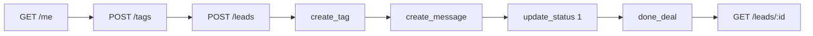
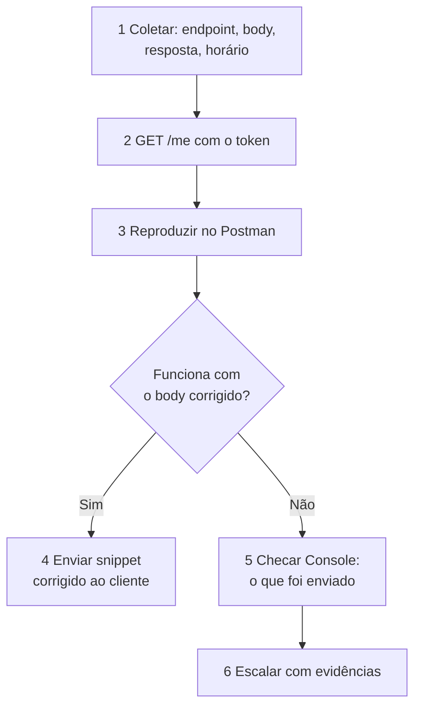

# Módulo 7 — Automação, simulação e diagnóstico

Junta tudo: rodar o fluxo inteiro sozinho, reproduzir o que o cliente faz, diagnosticar o erro e testar os endpoints por conta própria.

## Aula 7.1 — Collection Runner: executando o fluxo completo

**Prática:** 12 min

**Objetivo:** rodar o ciclo de vida completo de um lead automaticamente, com testes.

### Conceito

O **Collection Runner** executa as requests de uma pasta em ordem, sozinho. É uma automação que simula o sistema do cliente de ponta a ponta: cria a tag, cria o lead, aplica a tag, grava mensagens, muda o status e fecha o negócio.



No resto do curso você copia os IDs da resposta e cola na próxima request. No Runner não dá para parar e copiar: cada request precisa **salvar o ID sozinha** para a seguinte usar. Isso é feito com **scripts**, pequenos trechos de código que o Postman roda depois da resposta. Esta é a única aula do curso que usa scripts.

### Os scripts que você vai usar

Os scripts ficam na aba **Scripts → Post-response** de cada request. Você só precisa de três comandos:

| Comando | Faz |
| --- | --- |
| `pm.response.json()` | Lê o JSON da resposta |
| `pm.test("nome", () => ...)` | Cria um teste, que aparece verde ou vermelho no Runner |
| `pm.environment.set("variavel", valor)` | Salva um valor no Environment, para usar como `{{variavel}}` |

Em **todas** as requests da pasta, um teste de status:

```javascript
pm.test("Status 200 ou 201", () => pm.expect(pm.response.code).to.be.oneOf([200, 201]));
```

Em `POST /tags`, salve o ID da tag:

```javascript
pm.environment.set("tag_id", pm.response.json().tag.id);
```

Em `POST /leads`, salve o ID do lead:

```javascript
pm.environment.set("lead_id", pm.response.json().lead_id);
```

### Passo a passo

1. Crie a pasta `Fluxo completo` na collection.
2. Duplique para ela as requests do diagrama, na ordem (arraste para ordenar).
3. Nas requests que usam IDs, troque o ID colado pela variável:
    - *Path Variable* `id` das requests de lead = `{{lead_id}}`;
    - body do `create_tag` = `{ "tag_id": "{{tag_id}}" }`.
4. Cole os scripts acima na aba **Scripts → Post-response** de cada request.
5. Clique nos **...** da pasta → **Run folder** (ou no botão **Runner**, no rodapé).
6. No Runner: Environment `C2S - Conta de teste`, *Iterations* `1`, *Delay* `7000` ms.
7. **Run** → acompanhe cada request ficar verde ou vermelha, com os testes de cada uma.
8. Clique numa request do resultado para ver a request e a response completas.
9. Abra o lead no C2S e veja o resultado: tag, mensagens, status e venda.

**Antes de rodar:** confira as filas com Listar Filas de Distribuição (Aula 4.3). Se uma fila mandar leads para outra empresa do grupo, o Criar Lead dá 200, mas as etapas seguintes dão **404** porque o lead saiu do alcance do token. Veja o item 2 do “Antes de começar” da Aula 7.4.

### Delay

A API aceita **10 chamadas por minuto em cada endpoint**. A 11ª devolve **429** `Rate limit exceeded: 10 per minute` com `Retry-After: 1 minute`. Com *Delay* de 7000 ms você fica abaixo do limite mesmo repetindo o mesmo endpoint.

### Controle de fluxo

Para parar o Runner quando algo dá errado, use no *Post-response*:

```javascript
if (pm.response.code >= 400) {
  pm.execution.setNextRequest(null); // para o Runner aqui
}
```

## Aula 7.2 — Simulando a integração do cliente

**Prática:** 12 min
**Objetivo:** reproduzir no Postman exatamente o que o sistema do cliente envia e devolver ao cliente o código pronto.

### Conceito

Quase todo caso de API se resolve comparando **o que o cliente envia** com **o que funciona no Postman**. O Postman importa e exporta requisições em cURL, o “idioma comum” entre suporte, cliente e Dev.

### Passo a passo — importar a chamada do cliente

1. Peça ao cliente a chamada em cURL (a maioria das ferramentas exporta). Exemplo:

```bash
curl -X POST 'https://api.contact2sale.com/integration/leads' \
  -H 'Authorization: Bearer TOKEN_DO_CLIENTE' \
  -H 'Content-Type: application/json' \
  -d '{"name":"Joao","phone":"11999999999"}'
```

2. No Postman: **Import** (canto superior esquerdo) → cole o cURL → **Import**. Uma request pronta abre numa aba.
3. Se o cliente passou o token dele, use-o no Environment `C2S - Cliente X` (Aula 1.3). Senão, troque pelo `{{token}}` da conta de teste.
4. **Send** e compare com a Aula 2.5. Neste exemplo, falta a casca `data → attributes`: achado o erro.
5. Corrija o body e envie de novo.

### Passo a passo — devolver a solução

1. Na request corrigida, clique no ícone **</>** (*Code snippet*) na barra lateral direita.
2. Escolha a linguagem do cliente: *cURL*, *JavaScript - Fetch*, *Python - Requests*, *PHP - cURL*, *NodeJs - Axios*…
3. Copie e envie ao cliente, com o token substituído por `SEU_TOKEN`.

### Simulando ferramentas no-code

| Ferramenta do cliente | O que configurar nela | Equivalente no curso |
| --- | --- | --- |
| Make / Zapier / n8n | Módulo HTTP, POST, header `Authorization`, body JSON com casca | Aula 2.5 |
| Formulário de site | Envio do formulário para um back-end que chama `POST /leads` | Aula 2.6 |
| Receber avisos do C2S | URL de webhook do cenário → `POST /api/subscribe` | Aula 6.2 |

### Checklist de comparação

- [ ] Mesma URL e método?
- [ ] Header `Authorization: Bearer <token>` presente? (A API também aceita sem “Bearer”; se der 403 `access_denied`, o problema é o token.)
- [ ] `Content-Type: application/json`?
- [ ] Casca correta para o endpoint?
- [ ] Tipos corretos (número sem aspas, lista com colchetes)?
- [ ] Datas no formato do endpoint?

## Aula 7.3 — Roteiro de diagnóstico

**Prática:** 10 min
**Objetivo:** seguir sempre a mesma sequência num ticket de API e escalar só com evidência.

### Passos do diagnóstico



Quase todo caso termina no passo 4.

| Passo | Ferramenta no Postman | Aula |
| --- | --- | --- |
| 1 Coletar | — | 0.4 |
| 2 Validar token | `GET /me` | 1.4 |
| 3 Reproduzir | Import cURL, Environment do cliente | 7.2 |
| 4 Corrigir e devolver | Code snippet | 7.2 |
| 5 Provar o envio | Console | 1.1 |
| 6 Escalar | Exportar request + response | abaixo |

### Diagnóstico rápido por sintoma

| O cliente diz | Primeiro teste | Aula |
| --- | --- | --- |
| “Dá não autorizado” | `GET /me` | 1.4 |
| “O lead não chegou” | `GET /leads?phone=` + blocklist | 2.2, 5.4 |
| “Só vem 50 leads” | `meta.total` e paginação | 2.3 |
| “Foi para o vendedor errado” | Roteiro de distribuição | 4.7 |
| “Dá erro 423” | Telefone/e-mail no body | 2.5 |
| “Dá erro 422” | JSON, tipos e casca | 0.3, 3.7 |
| “O webhook parou” | Reinscrição com mesmo token | 6.4 |
| “A tag não aplica” | ID da tag, não nome | 2.9 |

### Como escalar

1. Na request que falha, **...** → *Share* ou copie o cURL pelo Code snippet (sem o token).
2. Na resposta, copie body, status e headers.
3. Anote: horário exato, `company_id` (de `GET /me`), `lead_id` se houver.
4. Escreva uma linha: “Com body correto e token válido, `<endpoint>` retorna `<status>` desde `<horário>`”.

## Aula 7.4 — Roteiro de testes dos endpoints

**Leitura:** 15 min

**Objetivo:** Testar sozinho, no Postman, todos os endpoints principais da API e saber o que conferir em cada resposta.

### Conceito

Este é o roteiro usado para validar a trilha contra a API real. Siga a mesma ordem: cada etapa gera os IDs que a próxima usa.

**Stand de Vendas e Blocklist ficam fora dos testes.** Eles são só explicados no Módulo 5. Não execute essas chamadas: Blocklist com `remove_leads: true` remove ou redistribui leads, e Stand de Vendas depende de um módulo que nem toda conta tem.

### Antes de começar

1. **Token de uma conta de teste**, no Environment (Aula 1.3). Rode **Informações da Empresa** (`GET /me`) e confira o `company_name`.
2. **Olhe as filas de distribuição** com **Listar Filas de Distribuição**. Se uma fila de prioridade alta mandar leads para outras empresas do grupo (regra `users_hierarchy`, por exemplo), o lead que você criar pode sair do alcance do token: a criação dá 200 e tudo depois dá **404 “Lead não encontrado”**. Nesse caso, peça para ajustar a fila ou use o token da empresa que recebeu o lead (`company` na resposta de Criar Lead).
3. **Respeite o limite:** a API aceita **10 chamadas por minuto em cada endpoint**. A 11ª devolve **429** com `Retry-After: 1 minute`. No Collection Runner (Aula 7.1), use *Delay* de **7000 ms**.
4. Identifique tudo o que criar com um prefixo, ex.: `TESTE SUPORTE`.

### Ordem dos testes

**1. Leitura (não altera nada)**

| Endpoint | O que conferir |
| --- | --- |
| Informações da Empresa `GET /me` | Nome da empresa e `sub_companies` |
| Listar Empresas `GET /companies` | Lista `[{ id, name }]` |
| Listar Vendedores `GET /sellers` | Lista direta; `is_recipient` vem como `0` ou `1` |
| Listar Tags `GET /tags` | `data[]`; o filtro `name` não diferencia maiúsculas |
| Listar Regras de Distribuição | Lista direta com `cod_1..3`, `priority`, `seller_id` |
| Listar Filas de Distribuição / Listar Vendedores da Fila | IDs **numéricos**; anote o `next_seller` para restaurar depois |
| Listar Leads `GET /leads` | Total em **`meta.total`**; `perpage` no máximo 50 |

Teste também os filtros de Listar Leads:

| Filtro | Como enviar | Erro comum |
| --- | --- | --- |
| Data | `created_gte=2026-09-01T03:00:00Z` (**UTC com Z**) | `-03:00` ou só a data → 403 “invalid date” |
| Status | `status=novo` | `status=new` devolve 0, sem erro |
| Página | `page=2&perpage=50` | `perpage=80` → 403 “must be less than or equal to 50” |
| Telefone | `phone=5511999999999` ou `phone=11999999999` (com ou sem 55) | Só parte do número → 0 resultados |

`from_hierarchy_company=true` dá erro quando a página inclui um lead criado pela API: não use.

**2. Lead (crie um só e use em todos os testes)**

| Ordem | Endpoint | O que conferir |
| --- | --- | --- |
| 1 | Criar Lead | 200, `lead_id`, `received_by` e **`company`**. Teste também sem telefone e e-mail: 423 |
| 2 | Buscar Lead por ID | 200. Se der 404, o lead foi para outra empresa (veja o item 2 do “Antes de começar”) |
| 3 | Atualizar Lead | 200 com `{ success, lead }` |
| 4 | Adicionar Tag ao Lead → Listar Tags do Lead → Remover Tag do Lead | Use o **ID** da tag (de Criar Tag); o nome dá 422. A lista mostra só IDs numéricos internos |
| 5 | Marcar Lead como Lido | `lead.read_at` preenchido. Se o lead já estava lido, mantém a data da primeira leitura |
| 6 | Criar Mensagem no Lead | 201 |
| 7 | Criar Atividade no Lead | 201; a atividade aparece em `schedulated_actions` |
| 8 | Encaminhar Lead | 200. Repita a mesma chamada: 422 `seller_from id not match`, porque o dono mudou |
| 9 | Atualizar Status do Lead (`1`, depois `2`) | 201; `message` é obrigatório (sem ele: 401 “Message cannot be empty”) |
| 10 | Fechar Negócio do Lead | 200; confira no log do lead (Buscar Lead por ID) “Integração marcou como negócio fechado” |
| 11 | Atualizar Status do Lead (`3`) | 201, `archive_details.archived: true`. Deixe por último: arquiva o lead de teste |

**3. Cadastros de apoio**

| Endpoint | Cuidado |
| --- | --- |
| Criar Tag (duas vezes) | A segunda vez devolve a mesma tag com `"errors": {}` |
| Criar Vendedor → Atualizar Vendedor → Batch Update Timeshift | Crie com `is_recipient: false` e `show_in_metrics: false`. **A API não exclui vendedor**: remova pela tela depois |
| Criar Regra de Distribuição | Use um `cod_1` que não bate com nada (ex.: `TESTE-SUPORTE`). A resposta não traz o id, e a API não exclui: remova pela tela. Repetir o mesmo body dá 422 `Essa regra já está cadastrada` |

**4. Filas (as chamadas mais delicadas)**

| Endpoint | Como testar sem alterar a fila |
| --- | --- |
| Definir Próximo Vendedor | Envie o **mesmo** `next_seller` que já estava |
| Atualizar Prioridades dos Vendedores | Reenvie as prioridades atuais **com `"status": 1`** em cada item: `{ "distribution_queue_sellers": [ { "id": 123, "priority": 1, "status": 1 } ] }`. **Sem `status`, a API desativa o vendedor da fila** |
| Redistribuir Lead | Use o lead de teste: a fila escolhe o próximo vendedor. Confira `new_seller` na resposta e atualize o `lead_id` se ele mudar |

Depois de mexer em fila, rode **Listar Vendedores da Fila** e confira se tudo voltou como estava.

**5. Webhooks**

1. Pegue uma URL no [webhook.site](https://webhook.site).
2. **Assinar Webhook** nos três gatilhos, com a mesma URL: 200 `Subscribed successfully`. Um gatilho inexistente dá 422 `hook_action not found`.
3. Crie, altere e arquive o lead de teste e veja cada evento chegar ao webhook.site: `on_create_lead`, `on_update_lead` e `on_close_lead`.
4. **Cancelar Webhook** nos três gatilhos ao terminar.

### Como ler os erros durante os testes

| Status | Significa | Exemplo real |
| --- | --- | --- |
| 400 | JSON quebrado ou body sem `data` | `param_data_not_found` |
| 401 | Campo obrigatório vazio | `Message cannot be empty` |
| 403 `access_denied` | Token inválido ou ausente | `{"error":"access_denied"}` |
| 403 com `message` | Parâmetro inválido | `'perpage' must be less than or equal to 50` |
| 404 | Recurso fora do alcance do token | `Lead não encontrado` |
| 422 | Dado que não bate ou registro repetido | `seller_from id not match`, `tag not found, please create one`, `Essa regra já está cadastrada` |
| 423 | Lead sem contato | `phone_or_email_or_wpp_username` |
| 429 | Limite de 10 por minuto | `Rate limit exceeded: 10 per minute` |
| 500 | Body fora de UTF-8 | `malformed utf-8` |

### No suporte

Quando um cliente disser que um endpoint “não funciona”, repita a etapa correspondente deste roteiro com o token de teste. Se funcionar aqui, compare o body e os filtros do cliente com a tabela da etapa. Se falhar aqui também, você já tem o status, a mensagem e o horário para escalar.

### Exercício

Rode o roteiro inteiro numa conta de teste e anote, para cada endpoint, o status que recebeu. Compare com o que as tabelas desta aula dizem para conferir.

## Projeto final — Prova final

**Objetivo:** provar que você domina a trilha inteira.

A prova final sorteia **10 questões** dos testes de todos os módulos, do Módulo 0 ao 7. Acerte **7** para concluir a trilha e conquistar o título **Mestres da API** 🧙‍♂️.

Ela libera depois que você passa no teste de todos os módulos. Se errar, as questões são sorteadas de novo para a próxima tentativa.
